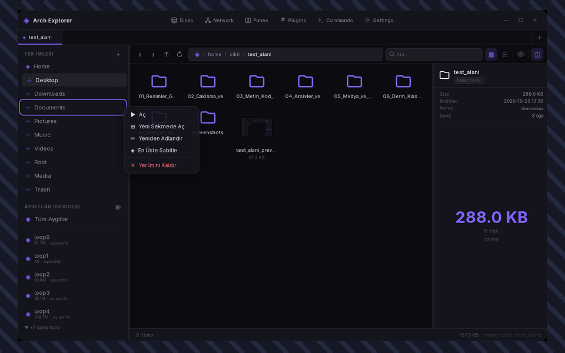
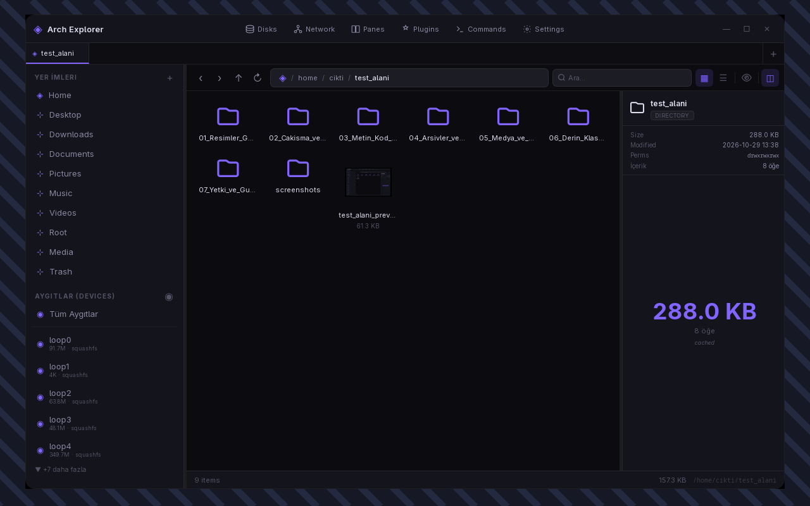
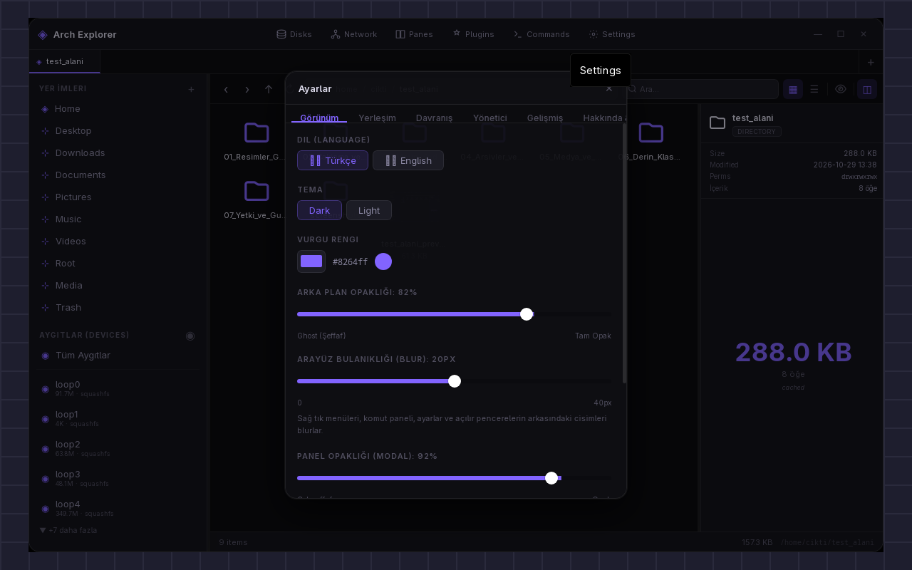
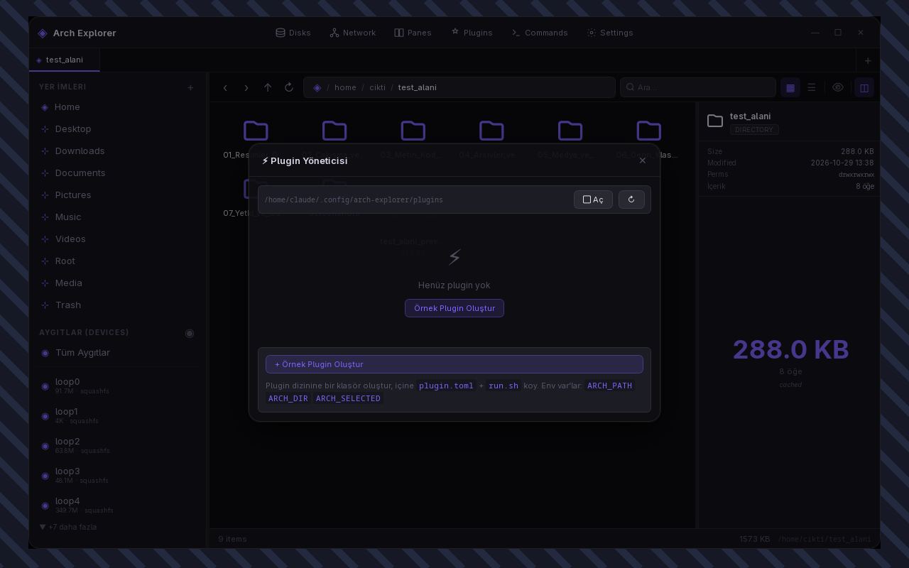
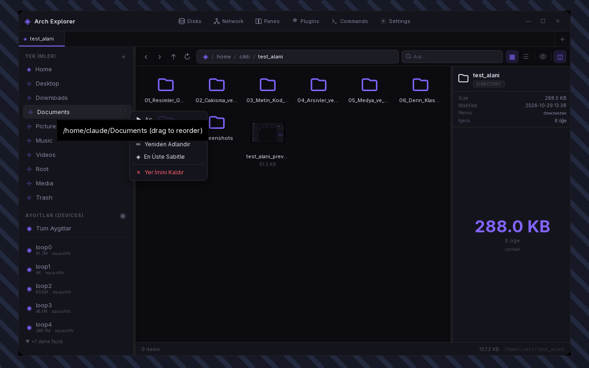

# ◈ Arch Explorer 0.1v

<p align="center">
  
</p>

<p align="center">
  <strong>Blazing fast, ultra-lightweight, transparent glassmorphism file manager designed for Arch Linux.</strong><br>
  Built with Rust + Tauri 2.0 + Svelte · Zero-lag · True Desktop Wallpaper Transparency
</p>

---

## ⚡ Direct Download & Quick Launch (No Dev Setup Needed!)

You don't need to build from source or install Node/Rust! The standalone binary and native Arch package are included directly:

### 1. Direct Instant Run:
```bash
git clone https://github.com/basihamam/arch-explorer-tauri.git
cd arch-explorer-tauri
./bin/arch-explorer
```

### 2. Native Arch Linux Install (pacman):
```bash
sudo pacman -U bin/arch-explorer-bin-0.1.0-1-x86_64.pkg.tar.zst
```

---

## 📸 Transparency & Visual Showcase

### Glassmorphism & Desktop Transparency
Arch Explorer lets your wallpaper and system theme shine through with hardware-accelerated blur and customizable opacity sliders.

<p align="center">
  
</p>

### Settings & Theme Customization
Live theme presets, accent color picker, interface blur (0–40px), and background opacity controls.

<p align="center">
  
</p>

### Layout & Folder Preview Controls
Configurable preview modes (Always, Automatic, Manual, Custom) and one-click toggle for Folder Previews.

<p align="center">
  
</p>

### Clean Context Menu & Trash Management
Quick actions, archive extraction, checksum verification, open-with manager, and trash restore.

<p align="center">
  
</p>

---

## ✨ Key Features

- **True Wallpaper Transparency & Blur:** Custom backdrop filters, acrylic transparency, and real-time blur adjustments.
- **Full Bilingual Localization:** Complete English (`en`) and Turkish (`tr`) support with dynamic, instant switching.
- **Smart Preview Panel:** Persistent file preview mode with configurable folder size calculation and background disk analysis.
- **Dual-Pane Support (Ctrl+P):** Two fully independent file panes for fast side-by-side transfers and comparisons.
- **Native Android / ADB Integration:** Connect any Android device via USB to browse, push, pull, and stream files.
- **Safe Undo & Conflict Management:** Overwritten files are automatically snapshotted; press `Ctrl+Z` to undo file operations.
- **Custom User Commands:** Add custom shell scripts and tools directly to the right-click menu via `~/.config/arch-explorer/commands.toml`.
- **Zero-Allocation Memory Manager:** Built-in Virtual Chunking, DU cache, and single-click RAM/cache cleanup for massive directories.

---

## ⌨️ Shortcuts & Hotkeys

| Shortcut | Action |
|---|---|
| `Alt + ←` / `Alt + →` | Back / Forward |
| `Alt + ↑` | Navigate to Parent Directory |
| `F3` | Toggle Preview Panel |
| `F5` | Refresh Directory |
| `Ctrl + P` | Toggle Dual-Pane View |
| `Ctrl + T` | Open Terminal at Current Folder |
| `Ctrl + Z` | Undo Last File Operation |
| `Alt + Enter` | View Properties & Permissions |

---

## 👤 Author & Community

- **Creator:** LordBlue / ALX ([@basihamam](https://github.com/basihamam))
- **Repository:** [basihamam/arch-explorer-tauri](https://github.com/basihamam/arch-explorer-tauri)
- **License:** Open Source Community Edition
